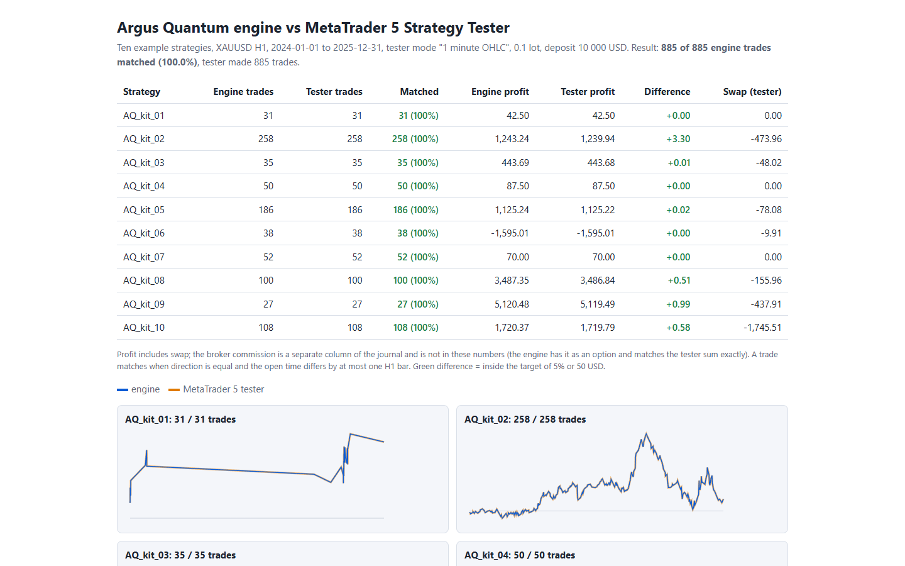
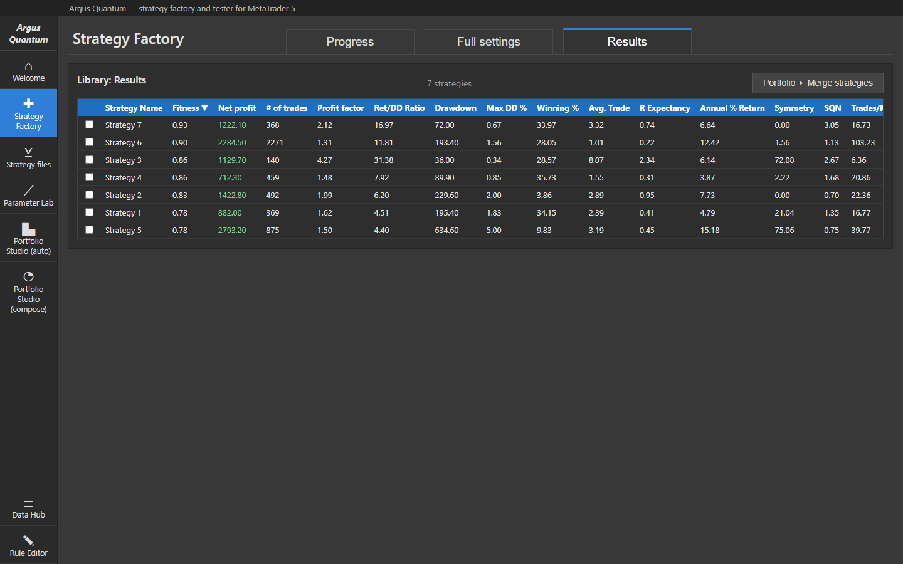
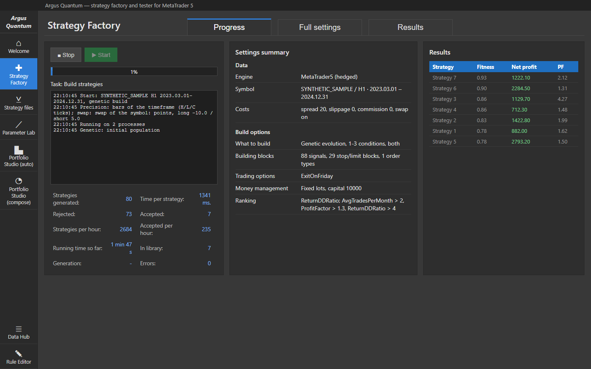
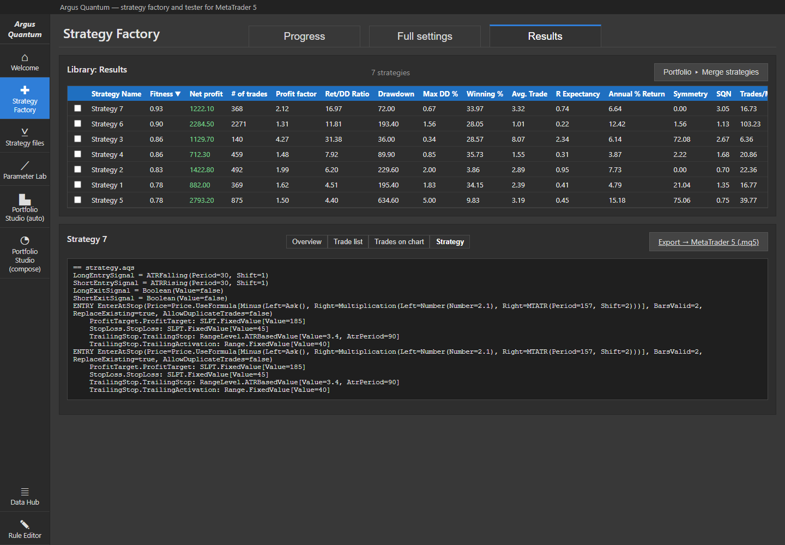
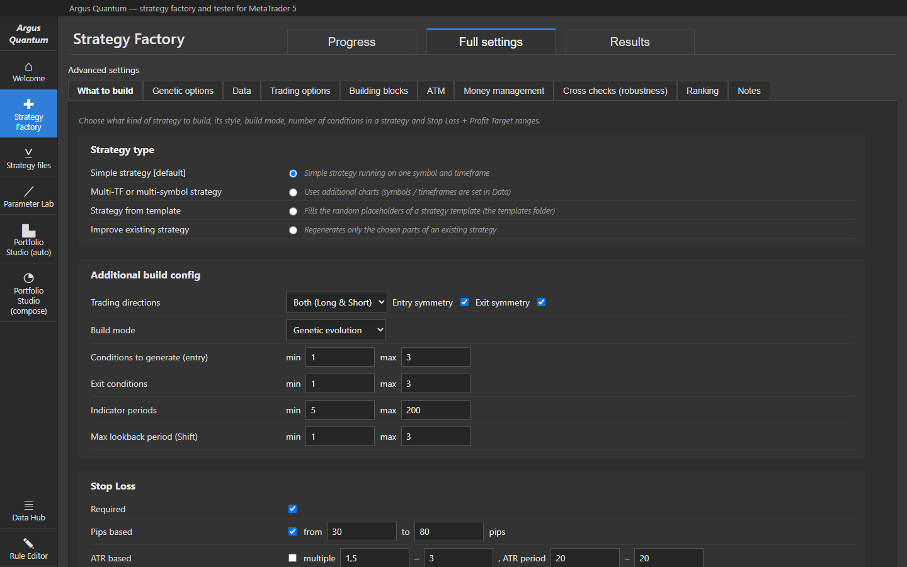
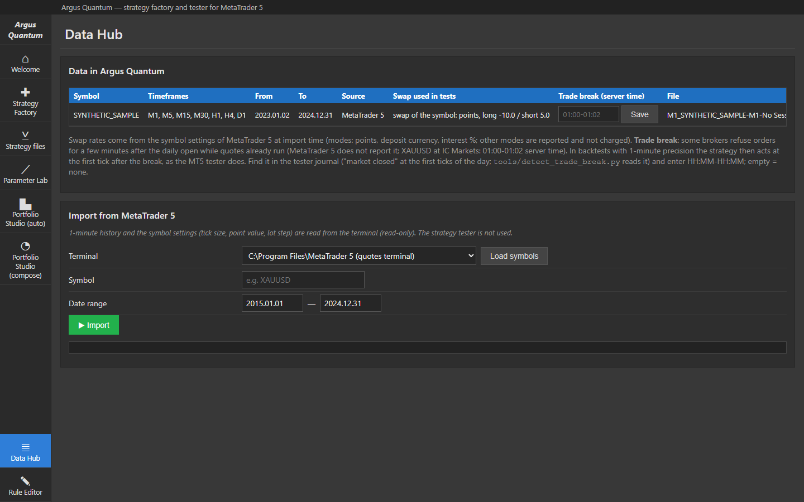
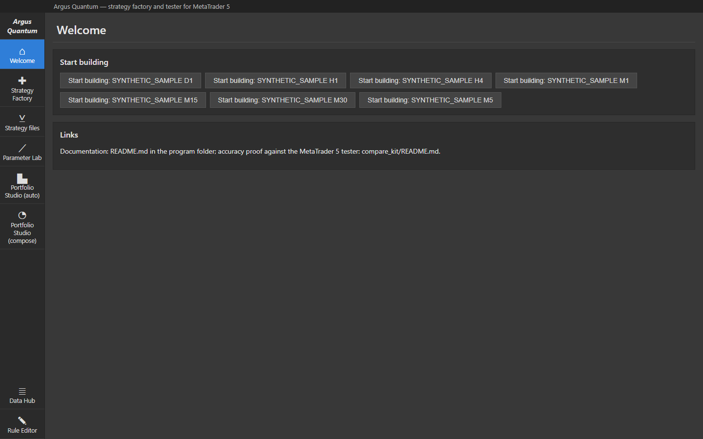

# Argus Quantum: strategy generator and MT5 Expert Advisor exporter

Argus Quantum generates thousands of rule-based trading strategies on your own data, back-tests and ranks them, and exports the ones you pick as clean, self-contained MQL5 Expert Advisors.

What makes it different is how close its back-test is to the MetaTrader 5 Strategy Tester. On the included test set of ten strategies, **885 of 885 trades match the MT5 tester and profit differs by at most 3.30 USD**. The full comparison kit is open in this repository, so you can check that claim yourself.

**Get Argus Quantum: [simplaitech.gumroad.com/l/argus-quantum](https://simplaitech.gumroad.com/l/argus-quantum)**

## Why the numbers match

Most back-testers guess what happened inside a bar. Argus Quantum does what the MT5 tester does:

- it walks through the broker's 1-minute bars inside every bar, in the tester's tick order, so stop-loss versus take-profit inside one hour is resolved the same way;
- it uses each minute's real spread from the broker's history, not a fixed spread;
- it charges swap from the symbol's own settings (Wednesday triple swap included);
- it respects the broker's daily trade break, when orders are refused for the first minute of the day;
- a position still open at the end of the test is not counted as a closed trade.

## Screenshots

| | |
|---|---|
|  |  |
|  |  |
|  |  |

The result screens show a demonstration build on the synthetic sample data that ships with the program. They are in-sample and are not a forecast or an example of live results.

## What you get

- **Strategy Factory:** random and genetic generation from about 460 building blocks (indicator conditions, price patterns, time filters, stop loss, take profit, trailing, break-even, exit after N bars, money management), filters, ranking and robustness checks (higher-precision re-test, other markets, Monte Carlo, walk-forward).
- **Parameter Lab:** simple and walk-forward optimisation.
- **Portfolio Studio:** automatic and manual portfolio selection by correlation and fitness.
- **Rule Editor:** build a strategy by hand from the same blocks.
- **Data Hub:** imports 1-minute history, spreads and symbol settings from your MetaTrader 5 terminal.
- **Export:** one `.mq5` file per strategy, no DLLs and no includes. All 120 strategies of the test corpus compile with 0 errors and 0 warnings.

Requirements: Windows 10/11 64-bit, Python 3.11+ (an install script sets up the packages), a browser, MetaTrader 5 for import and testing. It runs locally and sends nothing over the internet.

## Open in this repository

[`compare_kit/`](compare_kit) is the proof of accuracy:

| Path | What it is |
|---|---|
| `compare_kit/mq5/` | The ten Expert Advisors exactly as the program exported them. Read the code before you buy. |
| `compare_kit/python_trades/` | Trades of the Argus Quantum engine. |
| `compare_kit/mt5_t2/` | Trades the MetaTrader 5 tester made (written by the Expert Advisors themselves). |
| `compare_kit/compare_trades.py` | Matches the two lists trade by trade. |
| `compare_kit/report.html` | The full comparison with equity curves. |
| `compare_kit/README.md` | How to repeat the test on your own terminal. |

These files are MIT-licensed. The Argus Quantum program itself is proprietary and is not in this repository.

## Honest limits

- It is a research tool. It does not promise profit and does not trade for you. Test every Expert Advisor on a demo account first.
- 420 of the 464 engine blocks export to MQL5; the list of the others comes with the program.
- The 885/885 result is a measurement on ten strategies, one symbol and one broker's history. The kit is here so you can repeat it on yours.

## Buy

[Argus Quantum on Gumroad](https://simplaitech.gumroad.com/l/argus-quantum). Refund within 14 days if it does not start on a supported system and support cannot fix it. Questions before buying: open an issue here.

Also by SimplAiTech: [ARGUS V9 multi-account trading platform](https://github.com/SimplAiTech/argus-v9-mt5-trading-platform), [NinjaTrader 8 Python bridge](https://github.com/SimplAiTech/ninjatrader8-python-bridge).
